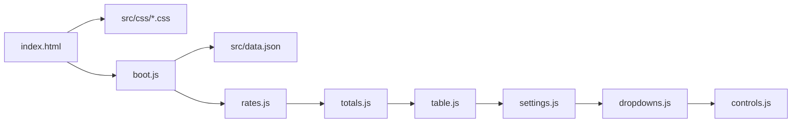

# aoe2vils.net: maintainer's guide

1. [Updating the data after a patch](#updating-the-data-after-a-patch)
2. [How the code works](#how-the-code-works)
   - [Files and folders](#files-and-folders)
   - [Diagram](#diagram)
   - [How the page starts](#how-the-page-starts)
   - [The scripts](#the-scripts)
   - [The data file](#the-data-file)
   - [Tests](#tests)
   - [Rules for changing the code](#rules-for-changing-the-code)

## Updating the data after a patch

A patch of the game may change what a unit or building costs, how long it takes, a gather rate or a civ bonus. The
page knows none of this by itself: every number is written into the data file, `src/data.json`. You need a text editor
(such as Visual Studio Code), a web browser, Git, Python 3 to serve the page on your own computer, and the patch notes.
One change takes about a quarter of an hour.

1. **List what changed.** From the patch notes, write down each change of a cost, a train or build time, a gather rate
   or a bonus. For costs, times, civs, bonuses and tech trees, [aoe2techtree.net](https://aoe2techtree.net) is the
   source of truth; the gather rates were measured by hand in the game.
2. **Find the entry.** Open `src/data.json` in the editor and search for the name in quotes, such as
   `"(Elite) Elephant Archer"`. A line whose units cost the same is one entry, named "(Elite) X" or "X-line"; if the
   search finds nothing, search for a word of the name.
3. **Change the numbers.** Each entry in `UNITS` is one line: `[name, group, wood, food, gold, stone, seconds, flags,
   age per civ, generic age, merged members]`. In `["Villager","Town Center",0,50,0,0,25,"","111…",1]` the Villager
   costs 50 food and takes 25 seconds. Change only the numbers, and keep the commas and quotes as they are: JSON allows
   no comments and no comma after the last item. Where the rest of the data is, see [The data file](#the-data-file).
4. **Look at it in the browser.** Browsers do not let a page opened by double-clicking read `src/data.json`, so serve
   the folder instead. In a terminal in the project's folder, run `python -m http.server 8000` and open
   `http://localhost:8000`. Pick a civ that has the entry, add the entry and check the cost and time beside its name
   and the villagers in its row. After each save, press Ctrl+F5. Stop the server with Ctrl+C.
   - A page that stays blank means `src/data.json` no longer reads as JSON, most often because of a missing or extra
     comma or quote. Press F12: the Console names the place. Visual Studio Code underlines the mistake as well.
5. **The patch number.** If the gather rates were measured again in the game, change the patch number in the
   Description of `.github/README.md`.
6. **Run the checks.** In Git Bash, in the project's folder: `bash .github/scripts/check-rules.sh`. Every line should
   say `ok`; a `FAIL` names the file and the rule: mend it.
7. **Record it.** In the last part of `documentation/DEVLOG/`, under today's date, write a section on what changed
   and from which patch.
8. **Commit and push.** GitHub Pages publishes the page at aoe2vils.net within a few minutes. Press Ctrl+F5 there to
   see it past the browser's cache.

## How the code works

The page is `index.html`, three style sheets in `src/css/`, seven scripts in `src/js/` and the data file
`src/data.json`. There is no build step and no library: the browser runs the files as they are. The one idea to grasp
first: for each row and resource, the villagers needed are the cost, divided by the time, divided by the gather rate;
the totals are rounded up to whole villagers. Every change of a setting runs the same chain, `refreshAll()`:
`syncSettings()`, `renderTechs()`, `renderCivFx()`, `renderRows()` (which calls `update()` for the numbers), `fit()`
and `save()`; a change of a count only needs `update()` and `save()`. The state is kept in the browser's
`localStorage` under `villagers-required.v3`. Parts 1 and 2 of the log hold the design chat and the notes on what the
page does and the wording the chief developer dictated; their line numbers and file names are older than the code.

### Files and folders

| File or folder | What it holds |
| --- | --- |
| `index.html` | The markup of both tabs. It links the style sheets and `src/js/boot.js`, and holds no CSS or JavaScript. |
| `src/data.json` | The data file: every name, number and text of the page, and its four fonts; see [The data file](#the-data-file). |
| `src/css/` | The style sheets, applied in this order, so a later rule wins: `base.css` (colours, fonts, the header, the controls, the dropdown lists), `sheet.css` (the resource boxes, the table, the technologies), `layouts.css` (the mid, narrow and phone layouts, and Transition Eco). |
| `src/js/` | The scripts; see [The scripts](#the-scripts). |
| `src/favicon.ico` | The page's icon. |
| `.well-known/` | `discord`, the file that proves to Discord that aoe2vils.net belongs to the project. |
| `aoe2-villagers-required-conversation.md` | The design chat the page was first built in, as exported. Part 1 of the log records it. |
| `documentation/` | This guide, `RULES.md`, `REQUIREMENTS.md`, `TESTS.md`, `DECISIONS.md`, `TERMINOLOGY.md`, and the development log in `DEVLOG/`. |
| `LICENSE` | The terms under which anyone may use the project. |
| `AGENTS.md` | What an AI agent must know before it changes anything here: what to read first, what it must never do, and when a change is done. |
| `.claude/CLAUDE.md` | The same for Claude Code, which reads this file by itself. It loads `AGENTS.md` and `RULES.md`. |
| `.claude/skills/` | Step-by-step procedures for AI agents, one folder each, such as how to write the development log. `ub-mode` is copied from another project and keeps its licence beside it. |
| `.claude/settings.json` | Stops Claude Code from committing and from changing `REQUIREMENTS.md`. |
| `.github/README.md` | Introduces the project; GitHub shows it on the repository's page. |
| `.github/` | What GitHub shows contributors: how to contribute, report a bug or a security hole, and the pull request form. |
| `.github/workflows/checks.yml` | Tells GitHub to run the checks and the tests on every push and pull request. |
| `.github/scripts/check-rules.sh` | Checks the rules a script can check; see [Tests](#tests). |
| `.gitattributes`, `.gitignore` | How Git treats line endings, and which files it leaves out. |

### Diagram

The arrows show the order in which the files load.



### How the page starts

1. `index.html` loads the style sheets, and its body starts hidden.
2. `boot.js` fetches `src/data.json`, hands the fonts in it to `document.fonts` and keeps the data as `DATA`.
3. `parseData()` in `boot.js` turns each matcher spec in `MATCH`, and the `m` of each effect, into a function.
4. The body is shown, and `boot.js` adds the other six scripts, in the order of `SCRIPTS`. The browser runs them one
   after the other.
5. `controls.js`, the last, calls `load()` to read the saved state, then draws the page.

The six are classic scripts that share one scope: a `const` or a function in one is seen by every script after it.
The first lines of `rates.js` take the data's keys out of `DATA` under their own names, such as `UNITS` and `TEXT`.

### The scripts

| Script | What it holds |
| --- | --- |
| `boot.js` | The start, above. |
| `rates.js` | `say()`, the saved state (`save()`, `load()`), the effects in force (`activeFx()`), the technologies of the civ (`civTechs()`), what an entry costs and takes (`effective()`), the gather rates (`rates()`) and the niche income. |
| `totals.js` | Lines and Post-Imp, number formats, row times, Farm Reseeding, fish trap rebuilding, House Building, the column headings, the sums of the rows, the extra-income lines (`EXTRA_LINES`, `showExtraLine()`) and the totals (`showTotals()`). |
| `table.js` | `update()`, the numbers of Transition Eco (`updateTE()`), the HTML of the rows, `renderRows()`, and fitting the header. |
| `settings.js` | Fitting the layout (`fit()`), adding a row (`addUnit()`), the table's events, the steppers, which technologies are open (`techOpen()`) and their titles, the income sources and `syncSettings()`. |
| `dropdowns.js` | The counts in the boxes, the lists of civ bonuses and technologies, `setCiv()`, the searchable dropdown (`combo()`) and the one for entries. |
| `controls.js` | The civ and ally dropdowns, the checkboxes, Idle TC Time, the tabs, the fields of Transition Eco, the Clear buttons, Post-Imp, and drawing the page at the start. |

Each script is close to 400 lines. Put new code in the script it belongs to; when one would pass 400, move whole
functions into the next. A function may be called while the scripts load only from its own script or a later one;
an event handler may call any function, since it runs once all have loaded.

### The data file

`src/data.json` holds the data the scripts read; the scripts hold none (Rule 27). Search it for the key.

| Key | What it holds |
| --- | --- |
| `CIV_NAMES` | The 56 civs, in the order of the characters of each entry's age per civ. |
| `UNITS` | Every entry: cost in wood, food, gold and stone, seconds, flags, and per civ the first age it has the entry, `0` for never. |
| `MEMBERS`, `EDGES` | Every single unit and building, and which upgrades into which; they make the lines. |
| `ALIAS`, `RENAMED` | Old names of entries, so that a table saved before a rename still loads. Add the old name when you rename one. |
| `LUMBER`, `FISH_SHIP`, `FARM_TABLES` | Gather rates per minute: trees by upgrade, Fishing Ships by spot and upgrade, farms by upgrades. |
| `BASE`, `FOOD` | Gather rates per second: gold and stone; berries, hunt, sheep and fish. |
| `MULT` | What each mining upgrade multiplies the rate by. |
| `NICHE` | The other income sources, such as the Feitoria and Trade Carts. |
| `FX` | The civ bonuses and team bonuses that change the numbers, each with its label. |
| `UT` | The unique technologies that change the numbers. |
| `MATCH` | The matcher specs: which entries a bonus applies to, by name. |
| `TEXT` | Every text the scripts write on the page. |
| `STATE` | What the page starts with before anything is saved, and what Clear All goes back to. |
| `FONTS`, `FONT_NOTICE` | The four fonts, Alegreya and Alegreya Sans, as base64, and their copyright. |

The rest are single numbers and small tables, each named for what it holds, such as `MAX_COUNT`, the most of one row.

A matcher spec picks entries. `{"flag":"U"}` picks those whose flags hold `U`; `{"names":["Villager","Monk"]}` those
two; `{"groups":["Dock"]}` those of the Dock; `{"is":"MIL"}` those `MATCH.MIL` picks. `{"any":[…]}`, `{"all":[…]}`
and `{"not":…}` combine them. A bonus in `FX` names its entries in `m`, such as
`{"k":"cost","m":{"names":["Mule Cart"]},"p":25,"label":"Mule Carts cost −{p}%"}`.

A text in `TEXT` may hold names in braces, which `say()` fills in: `"goldPerMin": "{n}g/min"` with
`say("goldPerMin", { n: 12 })` shows `12g/min`. Change the words freely, but keep the names in braces.

### Tests

There are no tests yet.

GitHub runs `.github/scripts/check-rules.sh` on every push and pull request. It checks what a script can check
without knowing the language of the code: that no folder holds too many files, that no two files share a name, that no
line or file of code is too long, that the development log keeps its form, and that `TESTS.md` numbers its tests 1, 2,
3 and so on. Run it yourself before you commit, from the project's folder:

```
bash .github/scripts/check-rules.sh
```

On Windows, run it in Git Bash. Each line says `ok`, `skip` or `FAIL`, and every `FAIL` names the file and the rule.

There may be at most 100 tests. When you add, change or remove one, update `TESTS.md`.

AI agents write code by `ub-mode`, which runs three tools that are not part of the project: crapper, which scores
each function by how complex it is and how much of it the tests run; dryer, which finds code written twice; and
mutator, which changes the code on purpose to see whether a test notices. They need Python 3.11 or newer. To have
them, clone them once next to the project's folder, in Git Bash:

```
cd ..
git clone https://github.com/cnordenb/crapper
git clone https://github.com/cnordenb/dryer
git clone https://github.com/cnordenb/mutator
```

The first run of each sets itself up. What they write in the project, `.metrics/` and `target/`, Git leaves out.
dryer runs on the scripts as they are: `../dryer/dryer -s src/js` from the project's folder. crapper and mutator need
tests, so they have nothing to run until the project has some. `AGENTS.md` lists the languages they work for.

### Rules for changing the code

`RULES.md` has the full list; `check-rules.sh` checks part of it.

- No file over 400 lines of code, no function over 60, and no line over 120 characters.
- No folder over 7 files, except `documentation/DEVLOG/`; the main folder may hold 8.
- No two files with the same name, except `SKILL.md`.
- No comments in the code. Explain what needs explaining in this guide instead.
- No CSS or JavaScript in `index.html` (Rule 5).
- All data in `src/data.json`: no name, number or text of the game in the scripts (Rule 27).
- HTML, CSS and JavaScript only, served as static files (Rule 24).
- No animations: nothing slides, fades or scrolls smoothly; every change shows at once (Rule 25).
- `REQUIREMENTS.md` defines what the project does, and only the chief developer may change it.
- Record what you change, and why, in the last part of `documentation/DEVLOG/`, under the day's date, and list any
  decision in `DECISIONS.md`.
- Only humans commit. AI agents leave their work for a human to read, test and commit.
